# La Totale Architectures Micro services Spring Cloud Spring AI MCP Angular
### Auteur : Hafssa Miftah Idrissi
### Master : SDIA2
### Module : Systèmes distribués
### Année universitaire : 2026/2027

---

# Partie 1 : Micro-services Backend (Customer, EBank, Gateway, Discovery, OpenFeign, Resilience4J)

Objectifs de cette partie :
- Développer le service Customer-Service
- Développer le service EBank-Service
- Communication entre les deux services avec OpenFeign
- Fault Tolerance avec Circuit Breaker : Resilience4J
- Développer la gateway
- Développer le Discovery Service
- Tester les services Backend avec un client REST : Postman et Swagger-UI

---

#### 1.1 Création du customer Service

- Création du service Customer : un module SpringBoot avec les dépendances suivantes : SpringWeb, SpringDataJpa, H2 Database, Lombok, Eureka pour discovery, ConfigClient pour configuration, actuator pour le monitoring des micro services, MCP pour le chatbot
- Création des packages : Entites, Repository, Service, Controller
- Initialisation d'un client via CommandLineRunner annoté @Bean et exposer l'application via le port 8056 avec l'ajout de la documentation swagger.

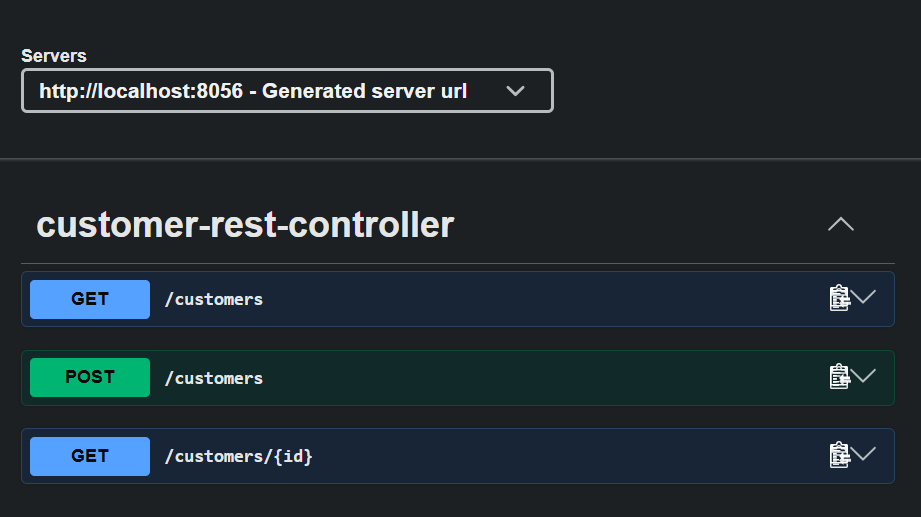
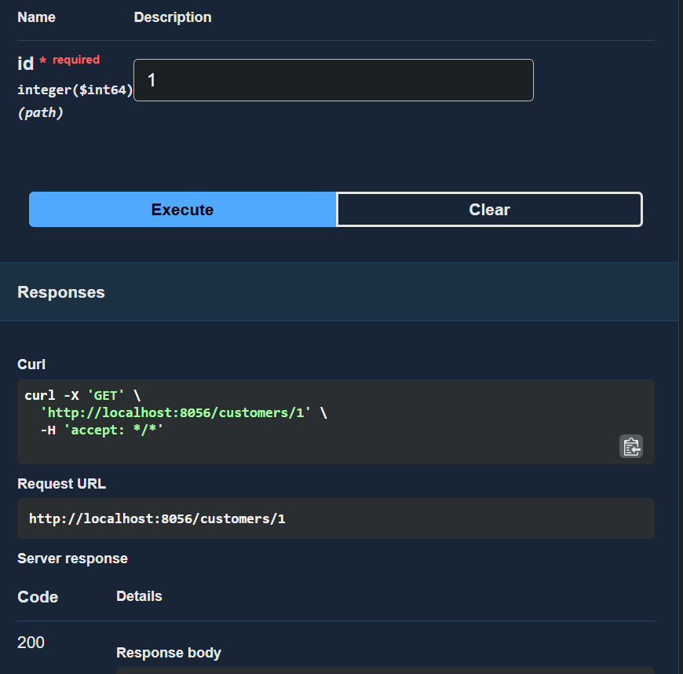
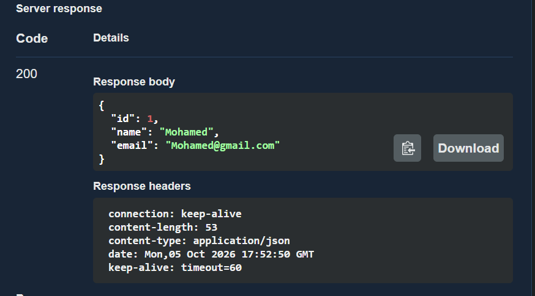

---

#### 1.2 Création du ebank Service

- Création du service Ebank : un module SpringBoot avec les dépendances suivantes : SpringWeb, SpringDataJpa, H2 Database, Lombok, Eureka pour discovery, ConfigClient pour configuration, actuator pour le monitoring des micro services, MCP pour le chatbot
- Création des packages : Entites, Repository, Service, Controller, Model pour contenir les informations du customer qui seront ajoutées dans l'entité BankAccount annotée @Transient
- Initialisation des comptes via CommandLineRunner annoté @Bean et exposer l'application via le port 8057 avec l'ajout de la documentation swagger.

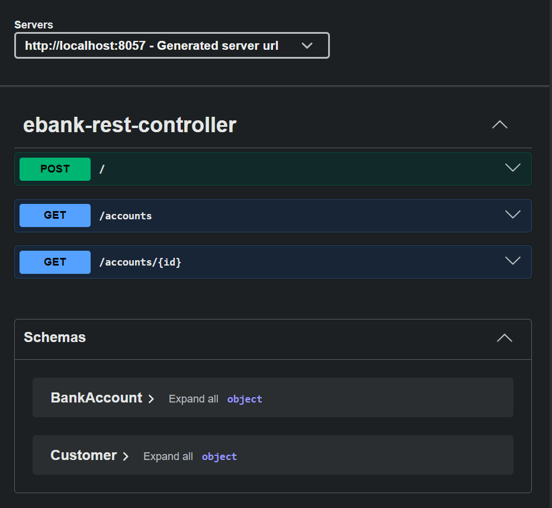
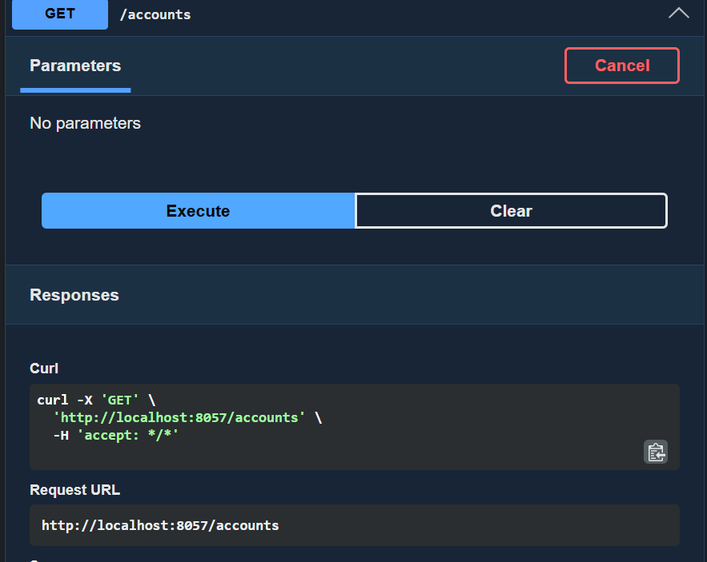
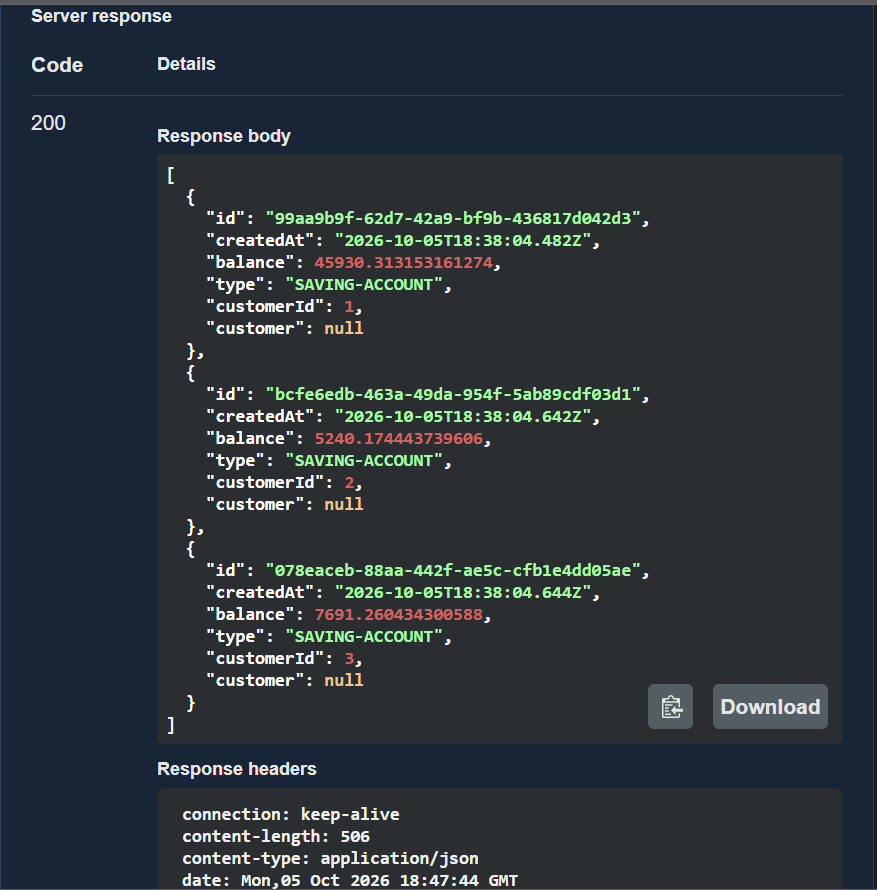

---

#### 1.3 Création du gateway Service

- Création du service gateway : un module SpringBoot avec les dépendances suivantes : Eureka pour discovery, actuator pour le monitoring des micro services, ReactiveGateway
- Création du fichier application.yml avec un routage statique des routes du customer service et ebank service

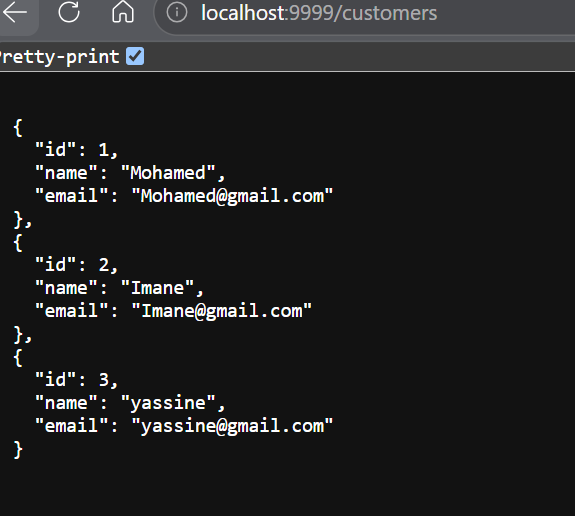

---

#### 1.4 Création du discovery Service

- Création du service discovery : un module SpringBoot avec les dépendances suivantes : Eureka pour discovery, actuator pour le monitoring des micro services
- Ajouter l'annotation @EnableEurekaServer
- Dans le fichier application.properties, configurer register-with-eureka et fetch-registry à false pour dire au discovery server de ne pas s'enregistrer sur lui-même
- Tester la connexion

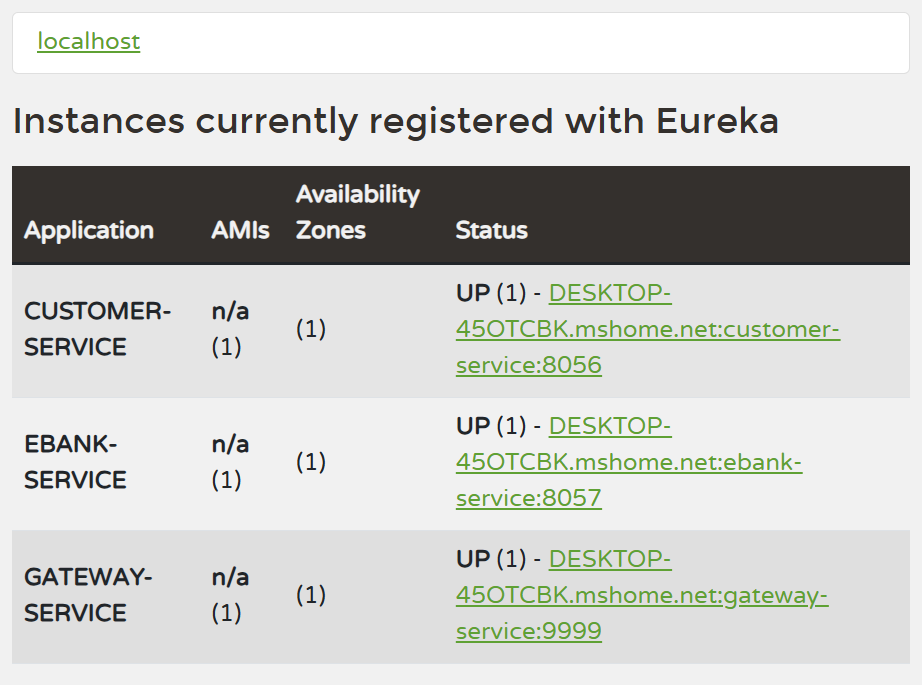

---

#### 1.5 Utilisation de OpenFeign pour la communication entre services

- Configurer le routage dynamique : en créant une méthode annotée @Bean de type DiscoveryClientRouteDefinitionLocator dans ebank-serviceApplication
- Ajouter la dépendance OpenFeign
- Ajouter le package Feign dans le micro service contenant l'interface CustomerRestClient avec l'annotation @FeignClient contenant le nom du customer-service pour le trouver à l'aide du discovery service
- Dans la couche service on injecte le CustomerRestClient et on l'utilise pour accéder aux informations du customer
- Dans ebank-serviceApplication on ajoute l'annotation @EnableFeignClients
- Tester l'accès au ebank service d'après le discovery et accéder aux customers

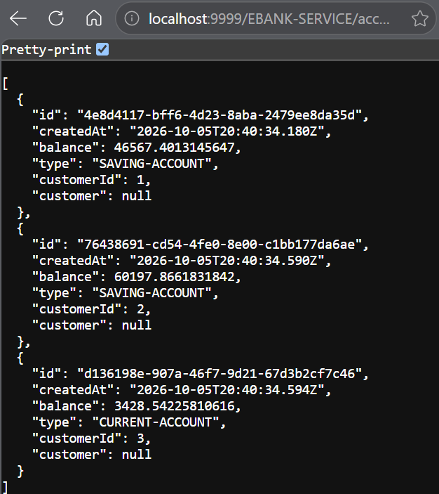
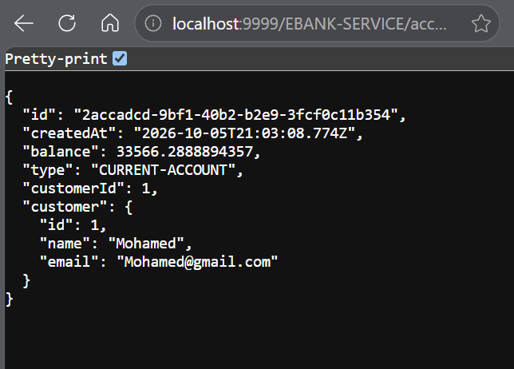

---

#### 1.6 Utilisation de Resilience4j pour résoudre les pannes (Fault Tolerance)

- Ajouter la dépendance Resilience4j
- Dans le package Feign, dans les interfaces Rest on ajoute l'annotation @CircuitBreaker avec une méthode Fallback qui affiche un client par défaut

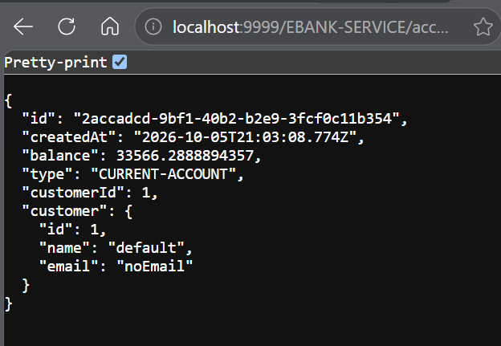

---

#### 1.7 Test des services Backend

- Les services backend ont été testés avec Swagger-UI (documentation exposée sur les ports 8056 et 8057) et avec un client REST (Postman), en passant aussi par la gateway et le discovery service (voir les captures des sections précédentes)

---
---

# Partie 2 : Agent AI avec Spring AI, MCP, Telegram et Discord

Objectifs de cette partie :
- Développer l'Agent AI basé sur Spring AI
- Exposer les fonctionnalités des micro-services via MCP
- Tester les micro-services via MCP Client
- Connecter le chatbot avec les micro-services avec MCP
- Tester le chatbot avec un client REST
- Tester le chatbot avec un client Telegram
- Tester le chatbot avec un client Discord

---

#### 2.1 Configurer le service chatbot (Agent AI basé sur Spring AI)

- Créer un service chatbot avec les dépendances : SpringWeb, OpenAI, EurekaDiscoveryClient, ConfigClient, SpringBoot actuator, Swagger
- Configurer l'api key et le port 8058
- Créer un package Controller avec une classe @RestController contenant un ChatClient

---

#### 2.2 Test du chatbot avec un client REST

- Tester avec un query=Bonjour

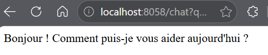
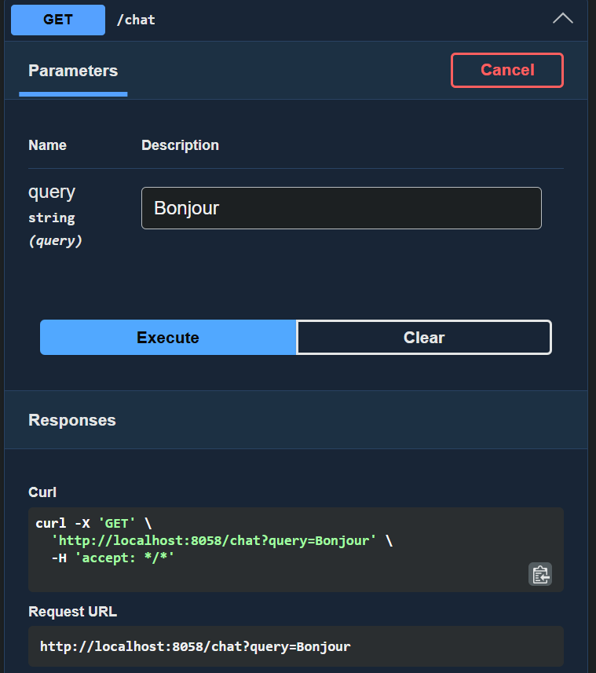
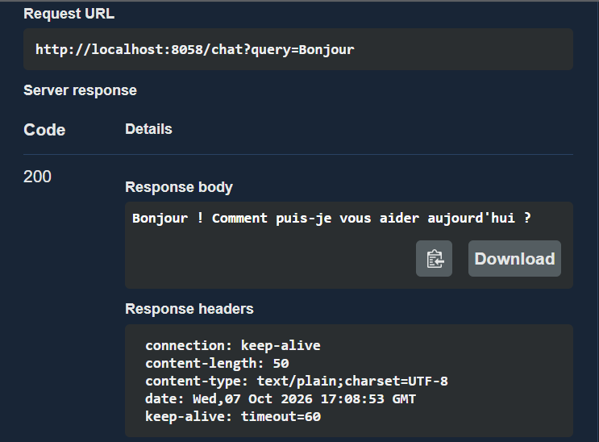

---

#### 2.3 Exposition des micro-services via MCP et connexion avec le chatbot

- Utiliser le MCP pour la connexion : ajouter la dépendance Mcp Server dans les microservices en exposant les méthodes dans le service avec @MCPTool en décrivant les tools pour le LLM et configurer le mcp avec la méthode streamable qui permet la connexion bidirectionnelle
- Ajouter la dépendance MCP client dans le micro service du chatbot et configurer en spécifiant les liens pour que le service se connecte aux serveurs mcp
- Ajouter le ToolCallbackProvider et tester

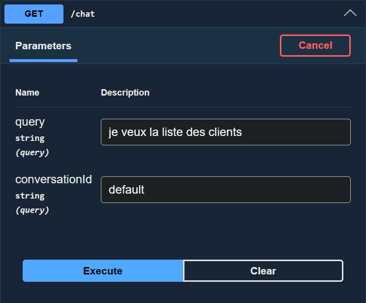
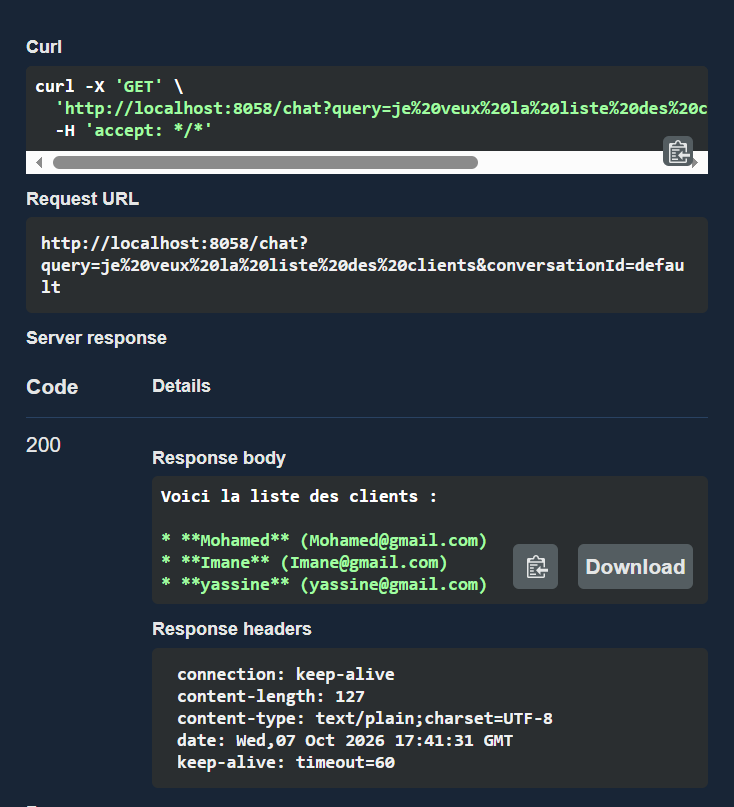
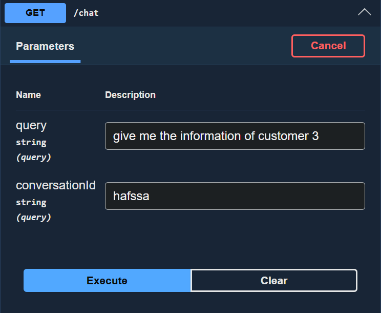
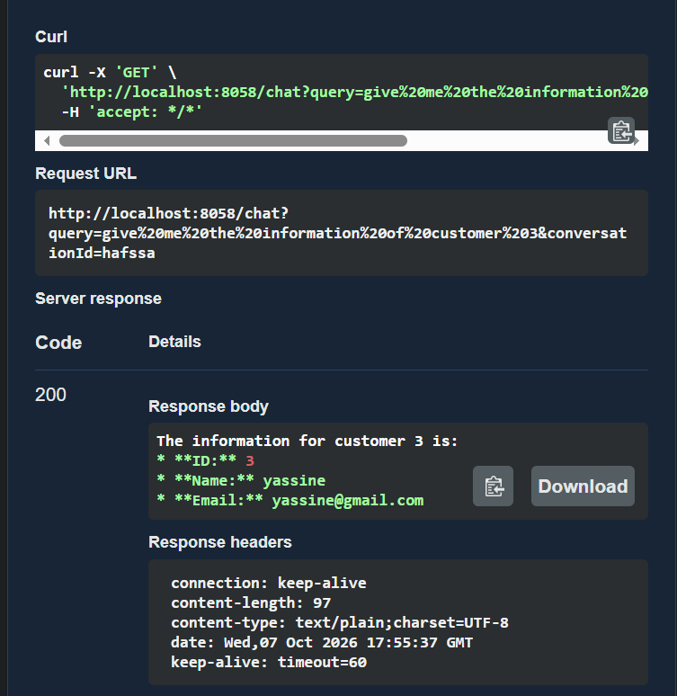

- Ajouter un System message pour limiter le contexte de réponse pour l'agent

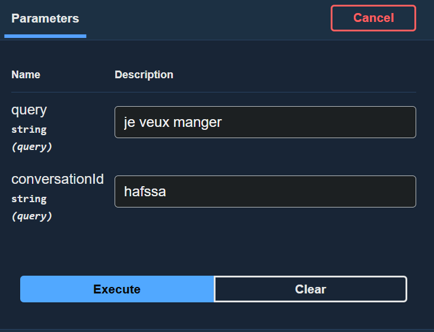
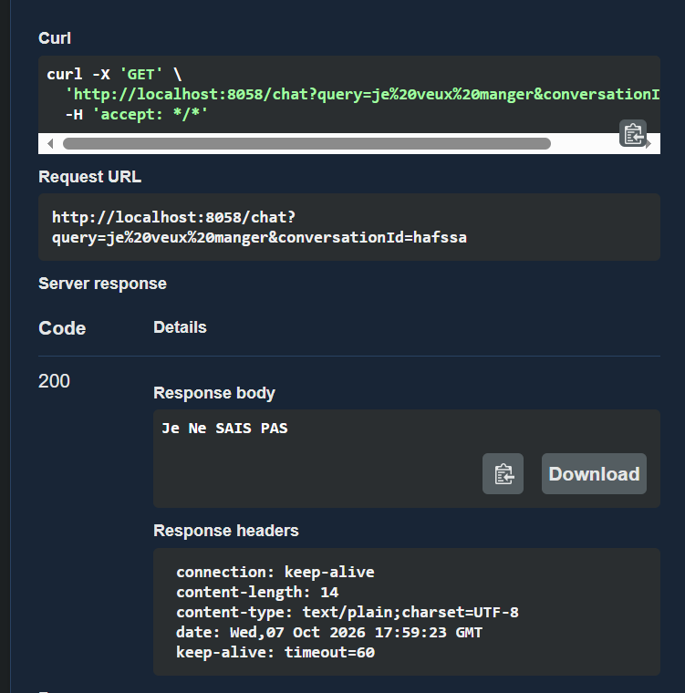
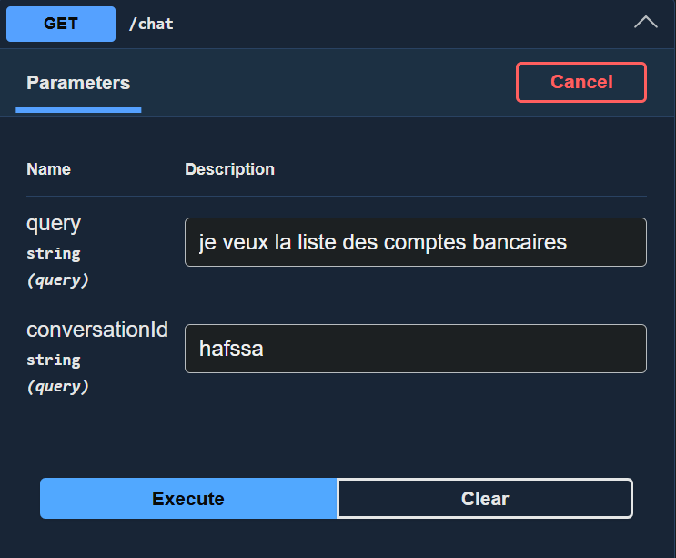
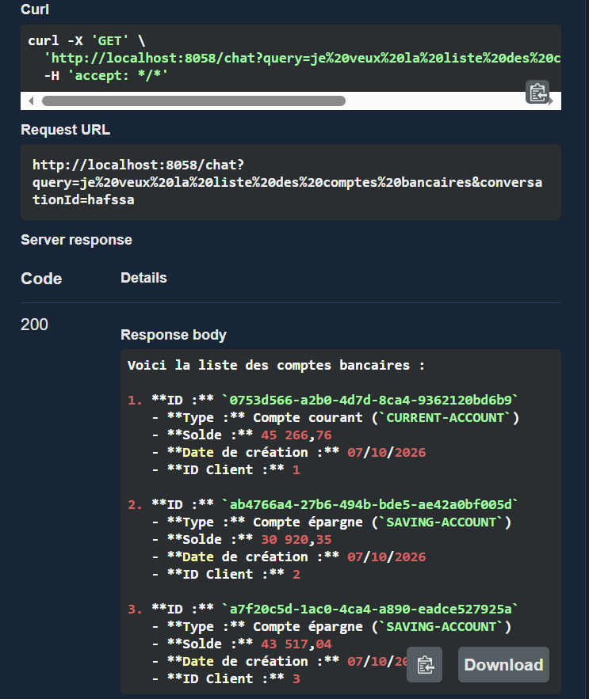

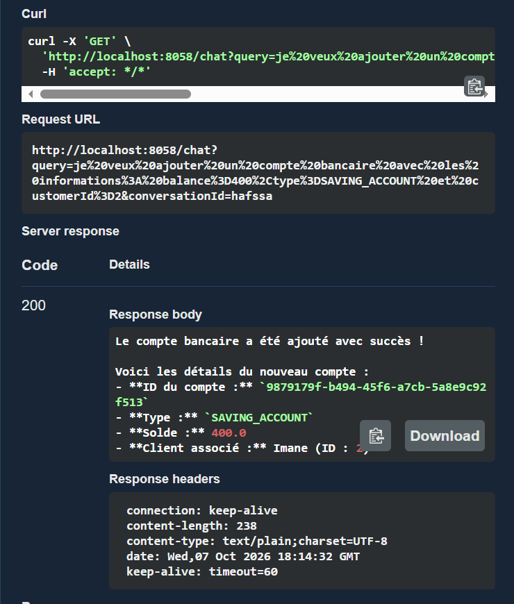

---

#### 2.4 Configurer la connexion avec Telegram

- Ajouter la dépendance du telegram dans le microservice ai agent
- Créer un package telegram dont on ajoutera une classe TelegramBot annotée @Component, Injecter le EbankAIAgent et hériter de TelegramLongPollingBot et utiliser le TelegramBotsApi
- Désactiver la création du Bean de Jersey par Eureka
- Tester

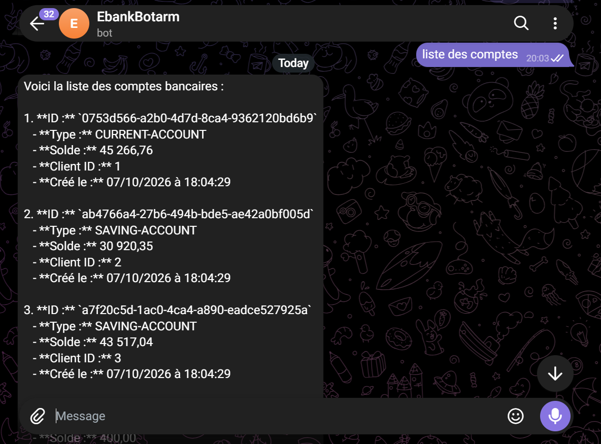

---

#### 2.5 Configurer la connexion avec Discord

- Ajouter la dépendance du discord dans le microservice ai agent
- Créer un package discord dont on ajoutera une classe DiscordBot annotée @DiscordController, Injecter le EbankAIAgent et ajouter une méthode de connexion avec @DiscordMapping
- Tester

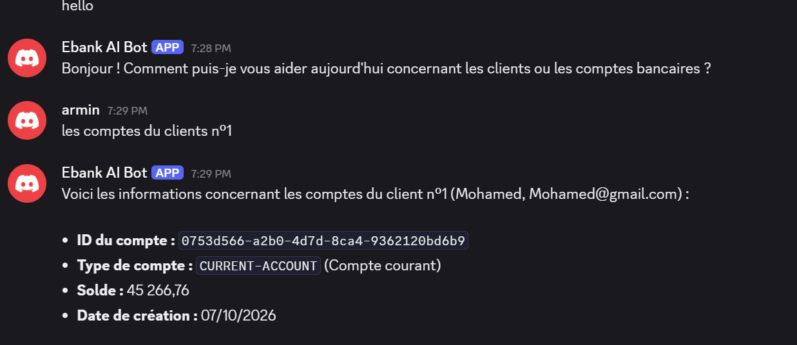

---
---

# Partie 3 : Front-end Angular

Objectifs de cette partie :
- Créer le projet Angular et afficher la liste des comptes via la gateway
- Gérer le loading (service + intercepteur + spinner)
- Intégrer le chatbot dans le front avec affichage en streaming

---

#### 3.1 Ajouter un Front Angular

- Création du projet Angular avec bootstrap et intégrer les dépendances dans style.css
- Ajout d'une navbar d'après bootstrap avec <router-outlet> à la fin
- Création du component accounts et configurer sa route dans app.routes
- Vérification du fonctionnement du backend :

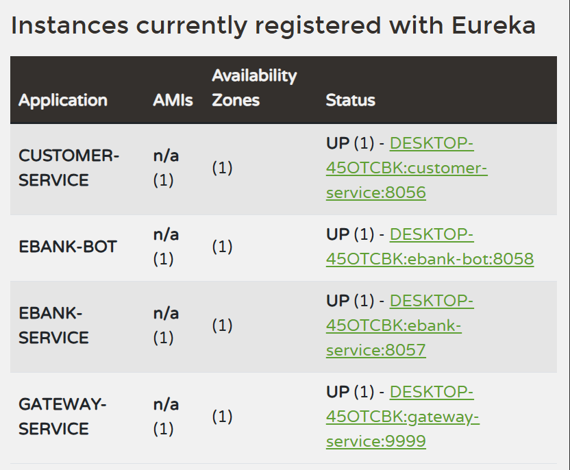
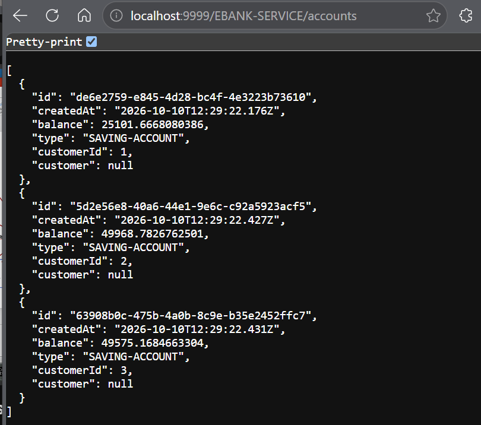

- Injection de l'HttpClient dans le fichier .ts et récupérer la liste des comptes via la gateway 9999, en faisant le subscribe dans le fichier html
- Résolution du problème du CrossOrigin dans la gateway dans le fichier properties.yml
- Création du folder model pour l'ajout des interfaces Accounts et AccountListState dans le fichier accounts.ts
- Test

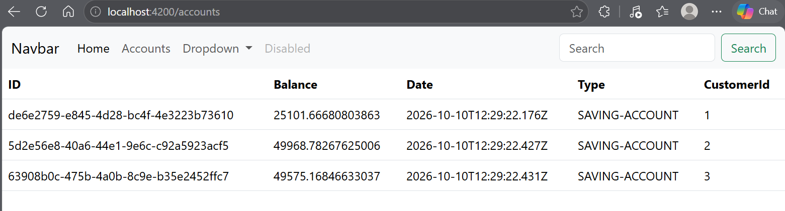

---

#### 3.2 Gestion du loading

- Génération d'un service loading pour centraliser cette étape entre les composants en utilisant un signal<boolean> on ajoute deux méthodes : isLoading et setLoading.
- Utiliser le service loading dans un intercepteur. Pour qu'à chaque fois qu'on envoie une requête elle passe via l'intercepteur.
- Déclaration du service loading dans les fichiers typescript des composants. Ensuite l'affichage du spinner dans le fichier html en utilisant ce service.

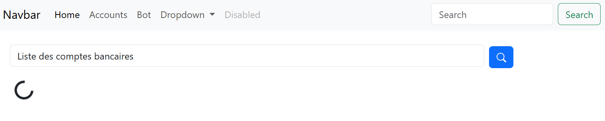

---

#### 3.3 Intégration du chatbot dans Angular (avec streaming)

- Génération d'un composant chatbot, et affichage des résultats des requêtes avec la dépendance Markdown et l'intercepteur du loading.
- Utilisation du streaming pour l'affichage des réponses en ajoutant dans le controller au backend du ebank-bot un autre endpoint chatStream qui retournera un Flux.
- Utilisation du Stream chat dans le front Angular.

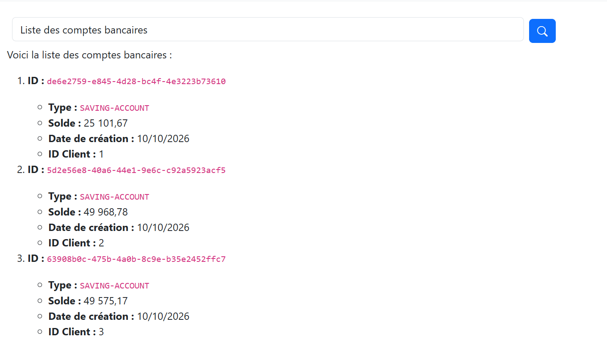
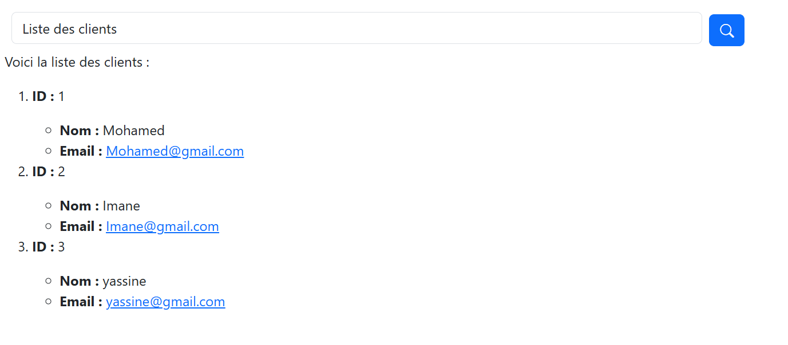
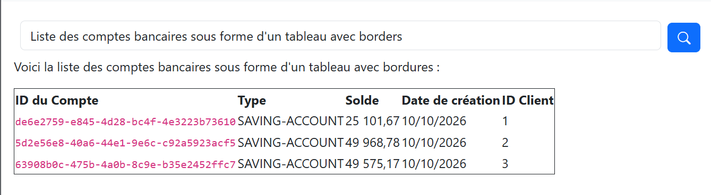
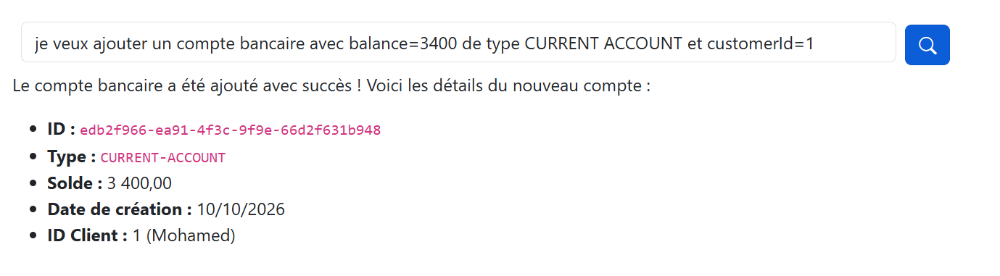
